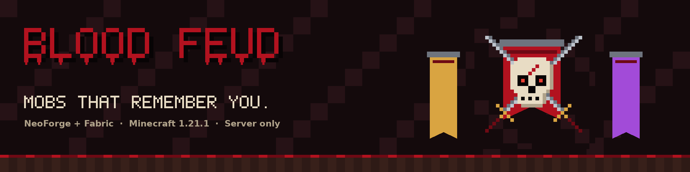

# Blood Feud

Mobs that remember you. Kill a few zombies while their friends watch and one of them walks away with a name, a
grudge and a level. Leave it alone and it gathers others of its kind into a pack, with a home, a color and a Boss.
Packs grow every night, fight the packs next to them, and the strongest swallow their own kind and crown a King.

Everything grows out of your fights. Nothing is planned ahead: every part of a big world grows its own packs and
rivalries around the places where players fight.

## How a nobody becomes somebody

- **It saw you kill its friends.** A mob that watches you kill three of its kind (within 16 blocks) and lives
  through the fight walks off as a named **Brute**: "You killed my brothers. I'm still here."
- **It killed you.** The mob that kills you becomes a Brute on the spot, and you are its **Nemesis**. A Brute that
  kills you again gets stronger.
- **It got away.** A Brute you run from gets stronger for driving you off.

A mob that rises doesn't stay to fight. It turns and walks off ("It will be back"), toward its pack's home if it has
one, and is gone once you can't see it, or within about 20 seconds. While it walks off it can't hurt you, even if you
hit it. It stays away about 5 minutes, across a restart too, then comes back, the same Brute with the same memory,
name and rank: hunting you down, leading a patrol of its pack, or meeting you at its home. A mob only ever rises once.

Brutes have a level, a name and an epithet, and a few traits: things it can't be hurt by (Arrowproof, Fireproof,
Unshakable, Watchful), things it is good at (Venom Blade, Bonebreaker, Thief, Blink, Berserker, Regenerating,
Packcaller, Shieldbearer, Night Stalker), ways to kill it fast (Headshot, Unguarded, Beast-Bait, Hallowed Bane, Glass
Jaw) and things it runs from (fire, wolves, cats, bells). You don't know any of them at first. You find them out by
running into them.

## Packs

Mobs only band with their own family: the **Rotten** (zombies, husks, drowned, zombie villagers), the **Bones**
(skeletons, strays, bogged), the **Illagers** (pillagers, vindicators) and the **Nether** (piglin brutes, wither
skeletons), the **Spiders** (spiders and cave spiders, who live in Nests) and the **Witches** (who gather in
Covens). Add modded mobs to a family with the entity tags `bloodfeud:rotten`, `bloodfeud:bones`,
`bloodfeud:illagers`, `bloodfeud:nether`, `bloodfeud:spiders` and `bloodfeud:witches`. Spiders and witches can't
show gear, so they get a tougher hide instead of armor and caps.

- At night a lone Brute pulls in plain mobs of its kind. When two Brutes of the same family meet, the stronger one
  becomes the **Boss** and the other its first Brute. That's a pack.
- A pack doesn't settle where it formed, which is where you fought it. It withdraws 150 to 400 blocks, to dry, level
  ground inside the world border that no other pack holds, and makes its home and camp there. Where there is no
  such ground (or in the Nether), it settles where it formed, as before.
- A pack holds the ground for about 500 blocks round its home and patrols it. Out there, away from its camp, a
  patrol can find you: a Brute (the one hunting you, if any) and a few grunts, coming from the direction of its home.
  Everything a pack sends out (patrols, its garrison, a Packcaller's grunts) comes out only in the dark (or in its own
  camp), away from anything you built, and its grunts drop nothing. When it's over they go back to the pack.
- A pack is named after the place it formed (the Mossy Bog Pack, the Cold Ridge Pack) and has a color. Its members
  wear leather caps in that color and the Boss wears the pack's banner.
- Packs grow every night, and faster for every player they kill. New Brutes rise inside the pack. A Brute that gets
  far stronger than its Boss challenges it.
- Packs with homes within about 1,500 blocks are rivals and raid each other. A pack that beats a rival of its own
  family swallows it, and its Boss becomes a **King**. Kill a King and its packs split apart again.
- Go near a pack's home and it comes out to meet you: the Boss, a couple of its Brutes and some grunts.

## Growing camps to towns

As a pack grows stronger, it claims ground at its home and builds out in four tiers:

1. **Camp** — a central campfire, banner totem, pitched wool tents in the pack's colors, and a Camp Stash chest.
2. **Outpost** — packed paths, a palisade wall with an arched gate, a two-story watchtower, a Boss Pavilion with a
   Boss Stash, and a family-styled work area (prisoner cages, archery range, cauldron shack, webbed brood den, soul
   brazier shrine, or bone pit).
3. **Stronghold** — fortified stone walls with battlements, four corner guard towers, a main gatehouse, an enclosed
   gabled Boss Hall, barracks, war forge, and training yards.
4. **Town** — a full gang-run town with outer walls, four gatehouses, lamp-lit avenues, a multi-story King's Hall
   flying vassal banners and holding the King's Treasury, a war monument square, tavern, town jail, blacksmith,
   smuggler market stalls, and gang houses. Crowning a King unlocks a Town right away.

If a pack's numbers drop below its settlement tier's threshold — from player raids, rival wars, losing its Boss or
King, or being wiped out completely — its Camp, Outpost, Stronghold, or Town falls into **ruins** (extinguished
campfires, collapsed roofs and walls, cracked/mossy family masonry, tattered banners, rubble, and cobwebs). If the
pack later rebuilds its strength back to its threshold, it restores its ruined settlement.

Every family builds in its own vanilla block palette, foundations adapt to hills, and automatic placement avoids
player-built bases and world spawn.

**You can watch them build.** While you can see a pack's site, a new camp, an upgrade or a repair goes up block by
block: a crew of the pack's own mobs clears the site, then walks to each spot and puts the block there, ground first,
then walls and roofs, with the stash and banners last. A crew of three places up to three blocks a second (less when
it has to walk), and a bigger pack sends more builders. A builder has to reach a block and see it to place it: it
never builds through a wall or from afar. One that can't walk to its spot is moved there only if the spot is safe to
stand on, and a block no builder can get at is put up off screen later (unless it's shut in where nobody could ever
see it). They mind their work while you watch from a distance, and turn on you if you come within about 8 blocks or
hit them. While nobody can see the site, it is built off screen instead, quickly, so you find it finished, or well
along, when you get there. It's one build either way: walk into view in the middle of it and the crew carries on from
the same block. The Ledger, `/bloodfeud packs` and the map say how far along a build is ("Camp, being built (40%)").

Kill the builders and the build stalls, half built, in view or not. The pack sends a new crew about five minutes later
if it's still around, and its Brutes remember who killed their builders. Builders are grunts, so killing them also
weakens the pack, but they drop nothing (not even their gear) and give no experience: a crew is no farm. A pack beaten
down mid-build falls to ruin, and the ruin (and any later repair) covers whatever it had already put up. A camp only
ever counts the blocks it put down itself, while they still stand, as its own: anything a player puts in the site is
left as it is, even across a restart, and the rest is built around it. A pack's site keeps room for a Stronghold, and
no other pack builds there.

Ruins, the crumbling of abandoned settlements, and banner changes still happen off screen, while players are away.

Settings in `config/bloodfeud.properties`: `campBlocksPerMinute` (each builder's pace, default 60),
`retreatMinDistance` and `retreatMaxDistance` (how far a new pack withdraws from the fight, default 150 and 400),
`patrolRange` (default 500), `patrolChancePercent` (default 20), `risenLeaveSeconds` (default 20) and
`risenRestSeconds` (how long a risen Brute stays away, default 300). Turn automatic
pack settlements off or back on anytime with `buildCamps=false` or `/bloodfeud camps off` and `/bloodfeud camps on`.

## Relics

Kill a Boss, a King or a Brute of level 10 or more and it drops its **relic**: a weapon named after it ("Vosk's
Blade", "Grak's Crown Cleaver") that is stronger than anything an enchanting table makes. Sharpness up to VIII,
Unbreaking V, Mending, extra damage and attack speed, and more for what the owner was: poison from a Venom Blade,
slowness from a Bonebreaker, Looting from a Thief, Fire Aspect from a burned one, extra speed or health from others.
Skeletons and pillagers drop bows and crossbows; spiders drop a poisoned Fang; witches drop a Hexblade that weakens
what it cuts.

## They talk

Brutes talk about what happened between you: the time it killed you, the item it stole, how many days you've been
running, the scar you gave it, the King it serves. Over 400 lines and 160 epithets, and a Brute never repeats itself
until it has run through what it has to say. Names are built from syllables, so you'll meet tens of thousands of
different ones. All of it lives in `bloodfeud/lines.txt` inside the jar.

## Dying, coming back, and scars

A Brute you kill can come back a day or so later, scarred by how it died (burned, broken, blasted, pierced, drowned,
cut or mauled), sometimes with a new trait or fear from it and a new epithet, and it comes looking for you. A kill is
**final** if the killing blow was a critical hit with a sword or axe, or it died in lava. A Brute that has come back
three times stays dead.

Scars show and change fights: Burned Brutes smoke and can set you alight, Blasted ones shed ash and shrug off
explosions, Drowned ones drip and can't drown, Cut and Mauled ones bleed (Cut ones hit harder, Mauled ones fear
wolves less), Pierced ones take less from arrows, and Broken ones limp but are hard to knock back. With the mod on your client, the
scars are painted on their bodies too: charred faces, stitched gashes, arrow holes, claw marks, soot, algae and
bandages.

## They take your gear

The Brute that kills you takes your best weapon and the armor you wore (not your helmet), puts it on, and fights you
with it. Kill it to get it all back. If it dies somewhere else, its pack's Boss takes the loot. Turn this off with
`takeGear=false`.

## No two alike

Every Brute has its own epithet (no two living Brutes share one), its own size (Bosses and Kings are bigger), and its
own armor trim pattern in its pack's color.

## The Ledger and the Map

With Blood Feud installed on your client, press **J** to open the Feud Ledger: an overview of who's after you, a page
for every pack and Brute you've met (with a 3D portrait, traits, scars, what it carries and what it remembers), and a
map of the land around you with every pack home you know. Players without the mod get the same information as a
written book and a map item.

Sleeping and dying move the feud along: each night, packs grow, fight and change hands.

## Big worlds

Packs stay within about 500 blocks of home and only feud with packs nearby, so each region grows its own. A pack
with no player within 2,000 blocks sleeps: it's a small record on disk, with no mobs and no chunks loaded. When
someone comes back it catches up on the nights it missed. A Brute that swore revenge follows you across the world at
about 2,000 blocks a day and turns up when it catches up. A world holds at most 64 packs; past that, the oldest
far-away pack no one has met fades away.

## On the Earth

[Earth Platform](https://github.com/pirut/earth-platform) is optional and needs no setup: packs settle at real
heights and leave player builds alone there too (tested with builds 76, 77 and 78, with and without Sable). The
Earth only keeps the ground near players loaded, so a settlement nobody can see has its ground loaded just for its
build, and let go after. With build 78 or later its cubes are kept for the build; with older builds they are asked
for until they are all there at once. Nothing is ever built into ground that isn't loaded. The Ledger's map and the Map of
the Feuds don't show the Earth's terrain, only where packs and Brutes are.

## Commands

- `/bloodfeud` (or `/bloodfeud packs`): the packs you've met around you, who leads them, and which way their home is.
- `/bloodfeud brute <name>`: a Brute's page: rank, level, what you know about it, scars, and your history together.
- `/bloodfeud nemesis`: who's after you.
- `/bloodfeud ledger` and `/bloodfeud map` (or **J**): open the Ledger screens, or give the book and map if your
  client doesn't have the mod.
- `/bloodfeud book`: the Feud Ledger as a written book. You get one free the first time a Brute finds you, and it
  rewrites itself each time you open it.
- `/bloodfeud mapitem`: a Map of the Feuds item, with each pack home you know marked by a banner in its color and a
  red X on each Brute hunting you.
- Operators: `/bloodfeud rise <family>`, `/bloodfeud camp <family> [camp|outpost|stronghold|town] [ruined]`,
  `/bloodfeud camp upgrade`, `/bloodfeud camp ruin`, `/bloodfeud camps [on|off]`, `/bloodfeud scar <scar> <name>`, `/bloodfeud night`,
  `/bloodfeud all`, `/bloodfeud forget everything`.

## Server only (screens optional)

Blood Feud runs on the server. Players don't need it installed: names, title cards, boss bars, lines, the book and
the map all use vanilla. Players who install it too get the Ledger and Map screens. Settings are in `config/bloodfeud.properties`.

NeoForge and Fabric, Minecraft 1.21.1. Blood Feud is inspired by the nemesis-style rivals of other games; its names,
lines and rules are its own.
