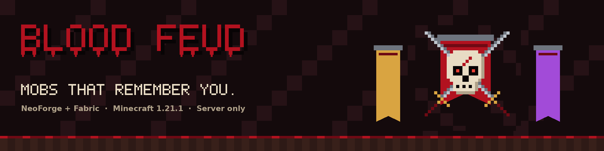
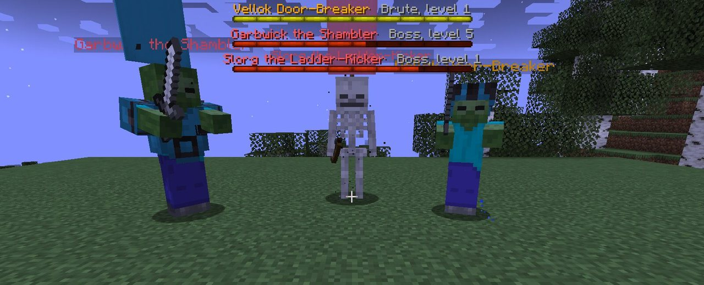
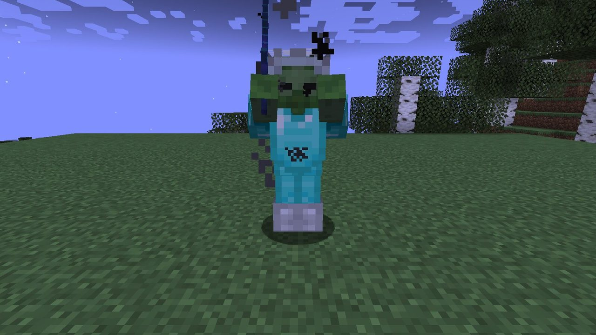
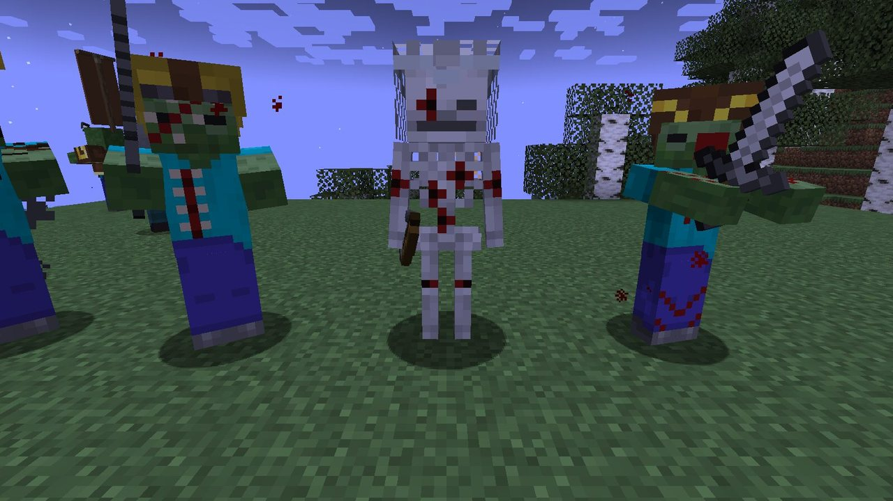
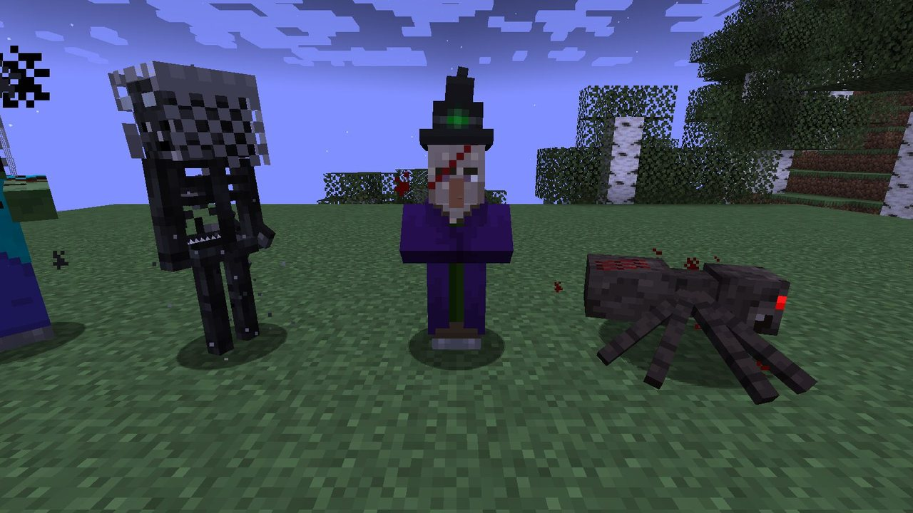
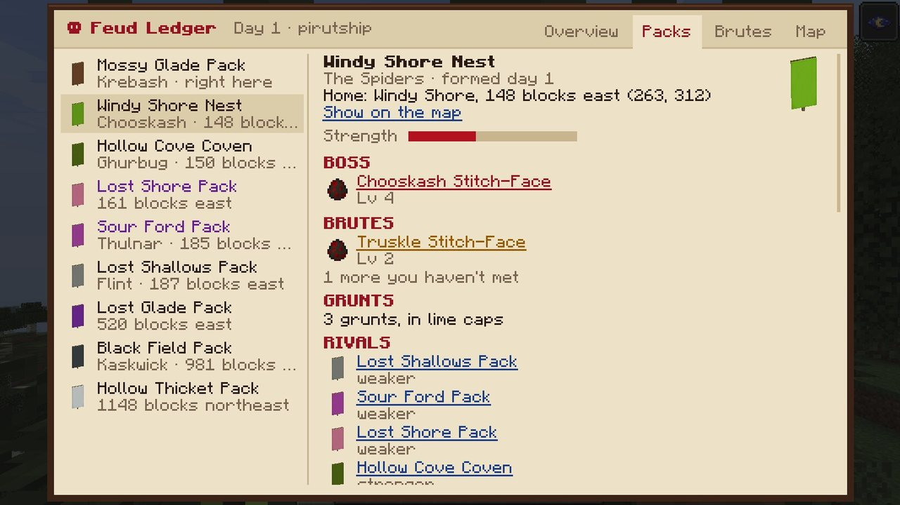
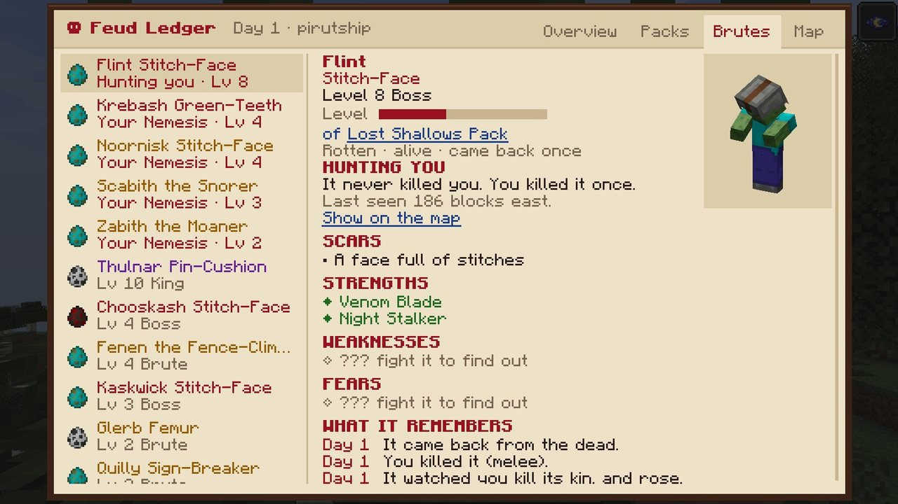
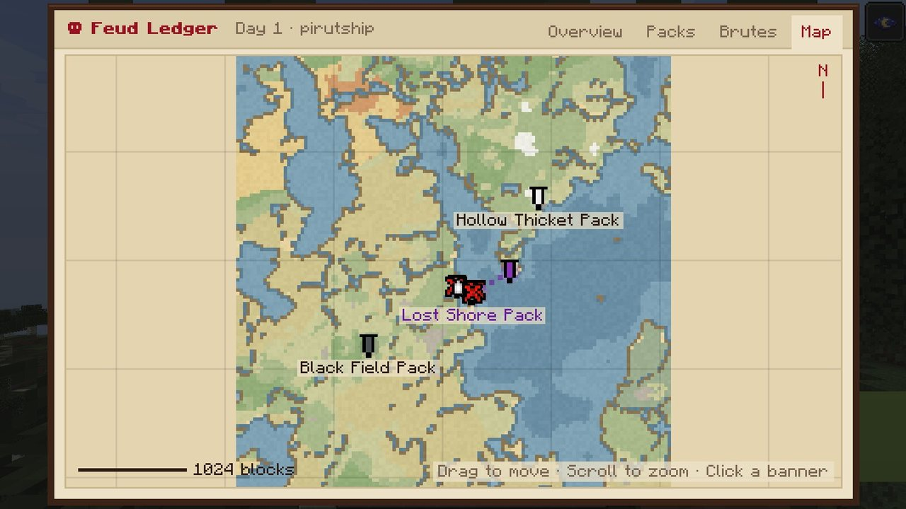

# Blood Feud

 
   

## Mobs that remember you.

**Kill a few zombies while their friends watch, and one of them walks away with a name, a grudge and a level.** Leave it alone and it gathers its own kind into a pack, with a home, a color and a Boss. Packs grow every night, raid each other, and the strongest swallow their rivals and crown a King.

Every world ends up with its own cast of villains, and every one of them got there because of something you did. It runs on **NeoForge and Fabric** for Minecraft 1.21.1, in singleplayer and on servers.

**👁️ They rise from your fights.** A mob that watches you kill three of its kind walks away as a named Brute. The mob that kills you becomes your Nemesis on the spot, and it won't let you forget it.

**🧪 They have traits you have to find out.** Immunities, tricks, weaknesses and fears: Arrowproof, Venom Blade, Blink, Thief, Headshot, Glass Jaw, fear of fire, wolves, cats or bells. You learn them by running into them.

**⚔️ They take your gear.** The Brute that kills you takes your best weapon and the armor you wore, puts it on and fights you with it. Kill it and everything drops back.

**🩹 They come back scarred.** Kill one and it may return a day later, marked by how it died: a charred face, a stitched gash, arrow holes, claw marks, soot, algae or bandages. Each scar changes the fight too. A burned Brute can set you alight, a blasted one shrugs off explosions, a pierced one takes less from arrows. Make the kill final with a critical hit or lava.

 

**🎲 No two alike.** Every Brute has its own name and epithet, its own size (Bosses and Kings stand taller) and its own armor trim in its pack's color.

**💬 They talk.** Over 400 lines about what actually happened between you: the time it killed you, the sword it took, how many days you've been running, the scar you gave it. It never repeats itself until it runs out.

**🏴 Six families.** The Rotten, the Bones, the Illagers, the Nether, the Spiders and the Witches. Each pack is named after the place it formed (the Mossy Bog Pack, the Cold Ridge Nest, the Ashen Pits Coven) and wears its color: dyed caps for the grunts, the pack's banner on the Boss.

**🏠 They have homes.** Walk near a pack's home and it comes out to meet you. Packs raid each other at night, and a pack that wins enough fights swallows its rival and crowns a **King**.

**📖 Press J.** The Feud Ledger shows who's after you, a page for every pack you've met (its banner, Boss, Brutes, rivals, your grudge and its story so far) and a page for every Brute: a 3D portrait wearing what it wears, the traits you've found out, its scars, what it carries and what it remembers about you.

**🗺️ The map.** A map of the land around you with every pack home you know. Players on a server without the mod on their client get the Ledger as a book and a map item instead.

 

**🗡️ Worth the fight.** Kill a Boss, a King or a strong Brute and it drops its relic: a weapon named after it and stronger than anything an enchanting table makes. Sharpness up to VIII, Unbreaking V, Mending, and powers from its owner: poison, slowness, Looting, fire, speed or extra health.

Far-away packs sleep as tiny records with no loaded chunks and catch up when you come back. A grudge follows you across the world at about 2,000 blocks a day. At most 64 packs per world.

- **Loaders:** NeoForge and Fabric, Minecraft 1.21.1. Fabric needs Fabric API.
- **Servers:** works in singleplayer and on servers. Players can join with a plain vanilla client; install the mod on your client too for the Ledger screens and painted scars.
- **Commands:** `/bloodfeud` shows the packs around you, `/bloodfeud brute <name>` a rival's page, `/bloodfeud nemesis` who's after you.
- **Settings:** `config/bloodfeud.properties` (turn off gear-taking, the free ledger, and more).
- **Alpha:** expect balance changes. Saves carry over between versions.
- **Open source** (LGPL-3.0). Built on Pirut Lib, which ships inside the jar.
