# CC: Agent

**Claude Code and Codex inside your [CC: Tweaked](https://modrinth.com/mod/cc-tweaked) computers.** Walk up to
a computer, type `claude`, and ask for what you want: a program that shows your base's power on a monitor, a
turtle that digs a tunnel, a door that opens for your friends. The agent writes the program on that computer,
runs it, reads the errors and fixes them, while you watch.

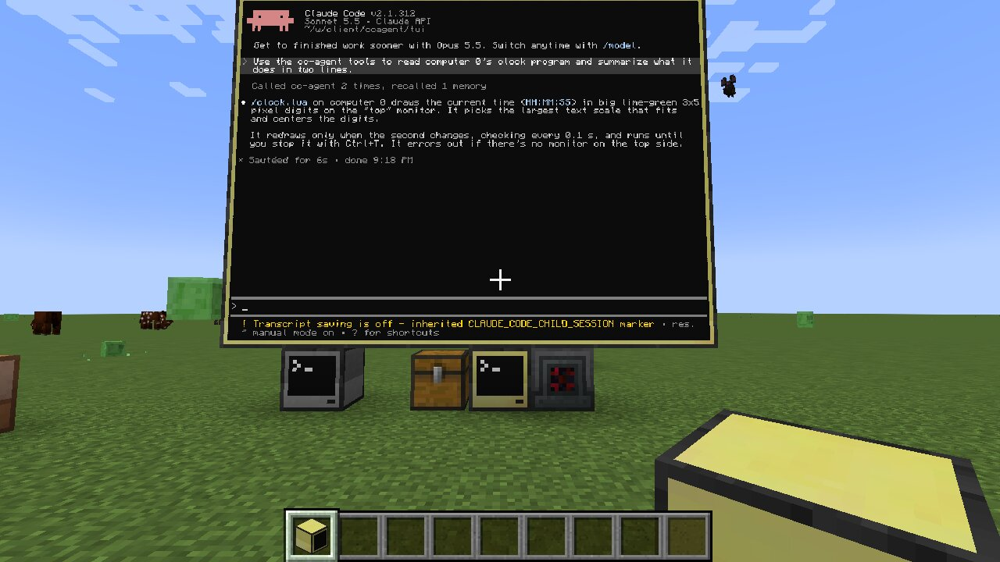

*The real Claude Code, on an 8x6 wall of advanced monitors, after reading and explaining a program.*

**[Download the latest release](https://github.com/pirut/mc-mods/releases?q=cc-agent)** ·
[Getting started](docs/getting-started.md) · [Using the chat](docs/chat.md) ·
[Troubleshooting](docs/troubleshooting.md) · [Changelog](CHANGELOG.md)

| | |
| --- | --- |
| Minecraft | 1.21.1 |
| Loaders | NeoForge 21.1 · Fabric (with Fabric API) |
| Needs | [CC: Tweaked](https://modrinth.com/mod/cc-tweaked) 1.120.0 or newer |
| On your PC | [Claude Code](https://code.claude.com/docs/en/setup) or [Codex](https://github.com/openai/codex), signed in once |
| Works in | Singleplayer, LAN and servers (install it on the server and in each player's game) |
| Systems | Windows, macOS and Linux |

## What it does

The agent runs on **your own PC, signed in to your own Claude or ChatGPT account**. There are no API keys and
no extra service. The mod gives the agent a set of tools for the CC world: list computers, read and write
their files, run programs and Lua, read the screen, use peripherals, drive turtles, look at nearby blocks. It
can only do what a CC computer could do.

There are three ways to use it:

| | How | Best for |
| --- | --- | --- |
| **Chat** | Type `claude` or `codex` on any computer | Asking for things while you play |
| **Full screen** | Type `claude --tui` with an advanced monitor attached | The real Claude Code / Codex screen, everything included |
| **Your terminal** | Connect Claude Code or Codex on your PC to the game once | Bigger jobs from your desk |

### The chat

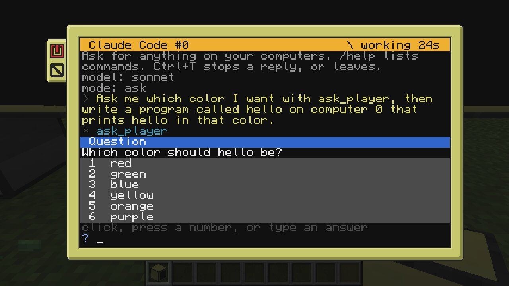

Talk to the agent right on the CC screen. Each step it takes shows as a line. It can ask you questions,
and you click the answer (or press its number, or type your own).

| | |
| --- | --- |
| 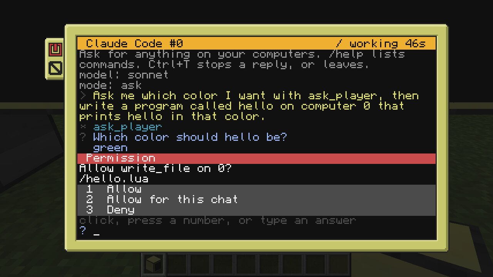 | 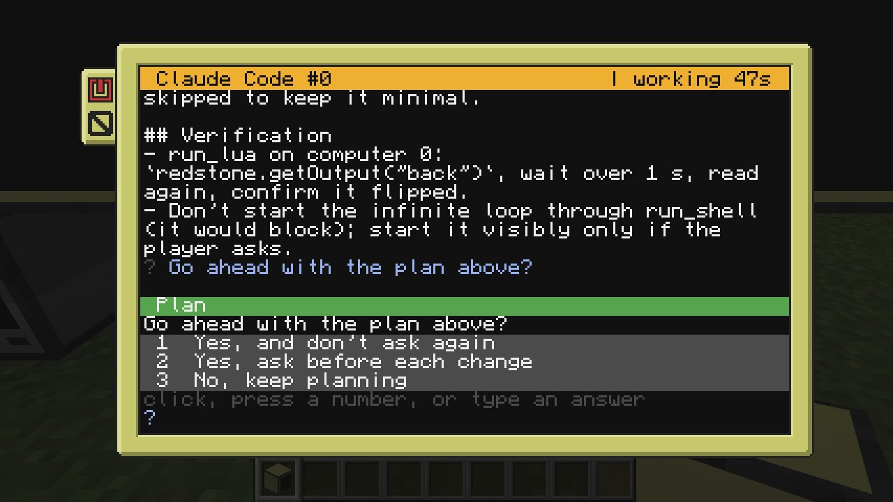 |
| **Permissions.** In *ask* mode it asks before anything that changes your world. | **Plan mode.** It looks around, writes a plan, and waits for your go. |

It has the same controls as the terminal version: `/model`, `/effort`, `/mode` (or Shift+Tab), `/resume`,
`/new`, and the agent's own commands like `/context` and `/compact`. You see its todo list while it works, you
can type your next message while it's busy, and the mouse wheel scrolls back through the conversation. See
[Using the chat](docs/chat.md).

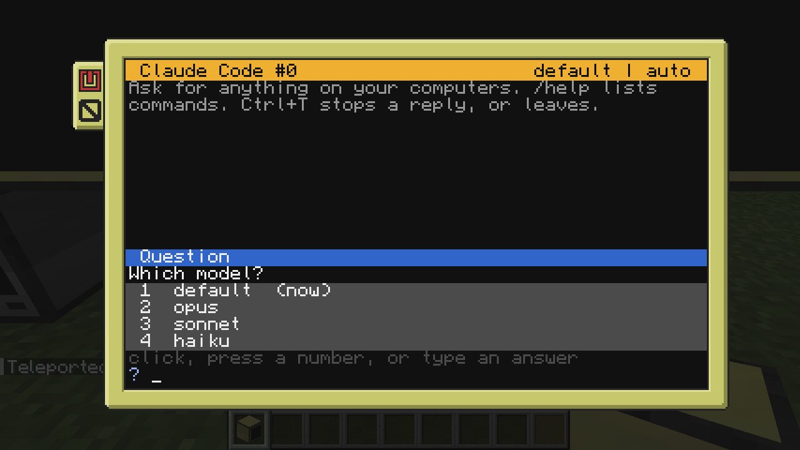

### The full screen

`claude --tui` and `codex --tui` run the agent's own terminal program on your PC and draw it on the biggest
advanced monitor attached to the computer. Everything the terminal version has works: slash commands,
permission prompts, plan mode, the lot. You type on the computer; its screen shows the part around the
prompt. Hold Ctrl+T to quit.

| | |
| --- | --- |
| 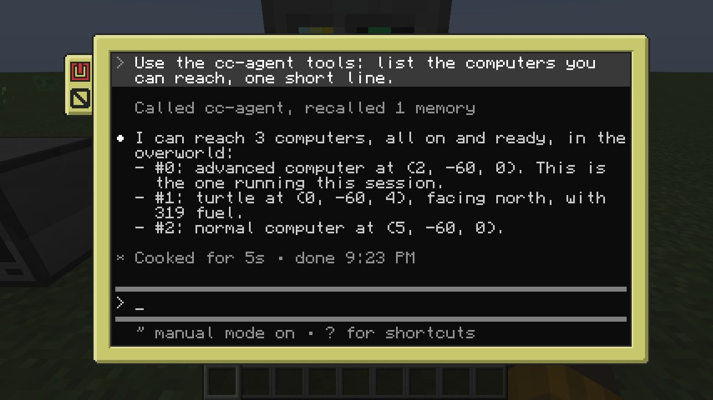 | 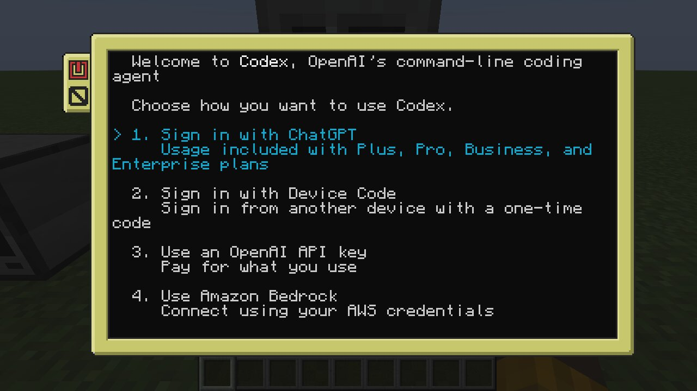 |
| Without a monitor (`claude --tui term`) it uses the computer's own screen. | Codex works too. |

### Your own terminal

Run `/ccagent claude` or `/ccagent codex` in game and click to copy a one-line setup. After that, Claude Code
or Codex in any terminal on your PC can see and use the computers in the world you have open. Any other MCP
client works too. See [Your own terminal](docs/terminal.md).

### Things it has built

| | |
| --- | --- |
| 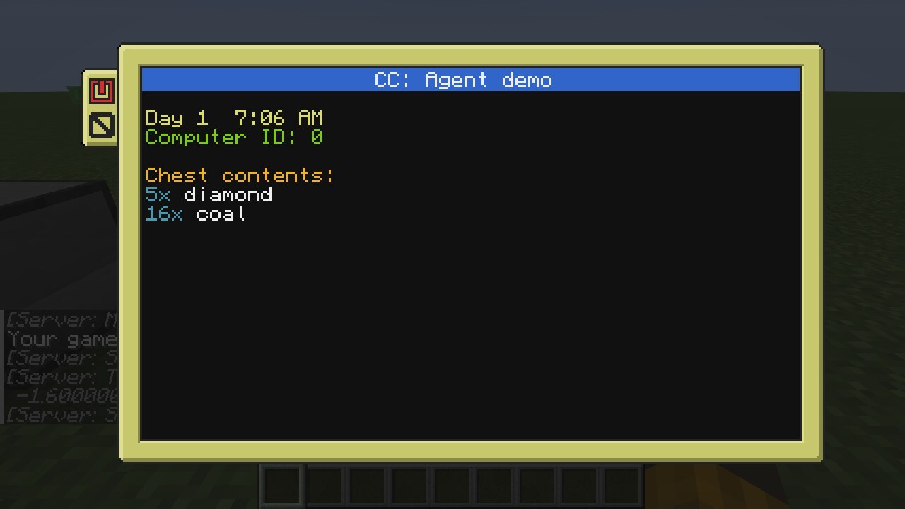 | 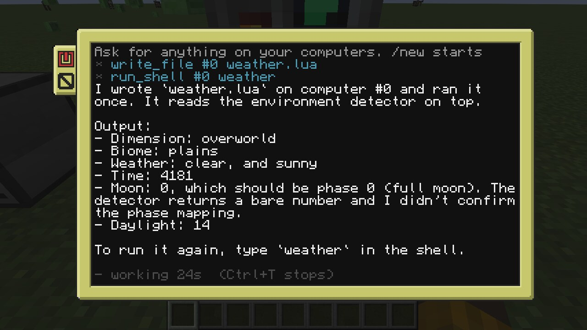 |
| A dashboard with the time and a chest's contents, written from one sentence. | Addon peripherals work too: here Advanced Peripherals' environment detector. |
| 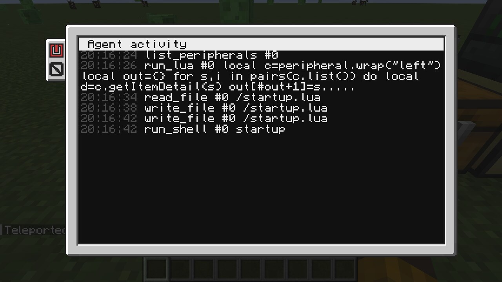 | 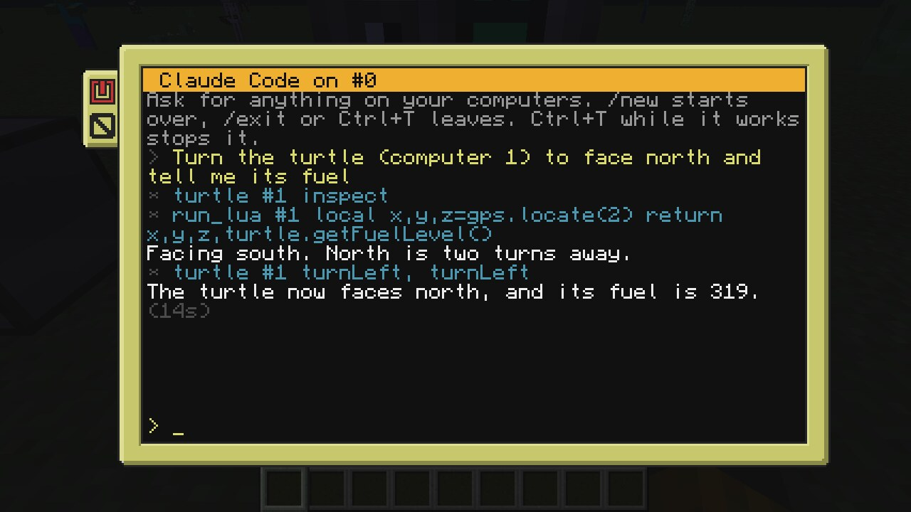 |
| `agentlog` shows every step an agent takes, live. | On servers, each player's agent runs on their own PC. |

## Quick start

1. Install [Claude Code](https://code.claude.com/docs/en/setup) or [Codex](https://github.com/openai/codex)
   on your PC, then run `claude` (or `codex`) in a terminal once and sign in.
2. Put CC: Tweaked and the CC: Agent jar for your loader in your `mods` folder. Fabric also needs
   [Fabric API](https://modrinth.com/mod/fabric-api). The jars are named
   `ccagent-neoforge-1.21.1-<version>.jar` and `ccagent-fabric-1.21.1-<version>.jar`.
3. Start a world, place an **advanced computer**, right-click it and type `claude`.

The [getting started guide](docs/getting-started.md) walks through every step, including the monitor wall.

**On a server:** put the mod on the server and in each player's game. Every player needs Claude Code or Codex
on their own PC. Server owners can limit range, rate and who may use it; see [Multiplayer](docs/multiplayer.md).

## Commands

| Where | Command | What it does |
| --- | --- | --- |
| CC computer | `claude`, `codex` | Open the chat. `claude <request>` starts with that request |
| CC computer | `claude --tui`, `codex --tui` | The agent's own full screen on the biggest attached advanced monitor. Add a monitor name (`left`) or `term` for this screen |
| CC computer | `agentlog` | Every tool call agents make, live. `agentlog right` shows it on a monitor |
| CC computer | `help claude`, `help codex`, `help agentlog` | The same in CC's built-in help |
| Minecraft chat | `/ccagent` | Whether the MCP server is running, and its address. Singleplayer host or operators only |
| Minecraft chat | `/ccagent claude`, `/ccagent codex` | Copy the setup for your own terminal |

To keep agents off one computer, run `set ccagent.enabled false` on it and reboot.

## Docs

- [Getting started](docs/getting-started.md): installing everything, first program, building a monitor wall
- [Using the chat](docs/chat.md): commands, modes, questions, permissions, keys
- [Your own terminal](docs/terminal.md): connecting Claude Code, Codex or any MCP client
- [Multiplayer](docs/multiplayer.md): servers, limits for server owners
- [Tools](docs/tools.md): every tool the agent gets, and how it runs code on a computer
- [Configuration](docs/configuration.md): every setting in `config/ccagent.properties`
- [Troubleshooting](docs/troubleshooting.md)
- [Testing checklist](docs/testing.md): what to try and how to report a bug
- [Changelog](CHANGELOG.md)

## Questions

**Does it cost anything?** The mod is free. The agent uses your own Claude (Pro or Max) or ChatGPT (Plus or
better) plan, the same as using Claude Code or Codex in a terminal, and counts toward that plan's limits.

**Do I need an API key?** No. Sign in to Claude Code or Codex once in a terminal and the mod uses that login.

**Does it work without an advanced computer?** The chat works on a normal computer too, without colors or
clickable buttons (press the answer's number instead). The full screen needs an advanced computer or an
advanced monitor.

**Can other players use my login on a server?** No. Each player's agent runs on their own PC with their own
login. The server only runs the tool calls, and never sees anyone's login.

**It says it can't find `claude` or `codex`.** Games started from a launcher often don't get your terminal's
PATH. Put the full path in `claudeCommand=` or `codexCommand=` in `config/ccagent.properties`. See
[Troubleshooting](docs/troubleshooting.md) for this and other fixes.

## Safety

- From the chat and the full screen, the agent only gets CC: Agent's tools and web search: it can't read
  your PC's files or run commands on your PC. It acts through the same CC APIs a program on the computer
  could use.
- The mod's MCP server listens only on `127.0.0.1` and needs a random token; web pages can't reach it.
- On servers, the agent runs on the player's PC. The server only runs the tool calls, with limits: range,
  rate, and operators only for command computers.
- Settings the chat passes to the agent (model, effort, session) are checked before they reach the command
  line, so a program on a server's computer can't use them to run anything on your PC. Keep the mod up to
  date on both the server and your game.

## Bugs and ideas

Open an issue at [pirut/mc-mods](https://github.com/pirut/mc-mods/issues) with "CC: Agent" in the title.
Say what you typed, what you expected and what happened, and attach `logs/latest.log`; the
[testing checklist](docs/testing.md) has more to try.

## Building

From the root of the [mc-mods](../../README.md) repo, with Java 21:

```sh
./gradlew :cc-agent:build              # both jars, and the tests
./gradlew :cc-agent:neoforge:runClient # a dev game (also :cc-agent:fabric:runClient)
```

Jars land in `mods/cc-agent/neoforge/build/libs` and `mods/cc-agent/fabric/build/libs`. `common/` holds the
shared code and the Lua programs; each loader folder adds only its entry point.

## License

LGPL-3.0-only. See [`COPYING`](../../COPYING) and [`COPYING.LESSER`](../../COPYING.LESSER). The jars bundle
[pty4j](https://github.com/JetBrains/pty4j) (EPL-1.0) and the Kotlin standard library (Apache-2.0) for the
terminal behind `--tui`.

CC: Tweaked is by SquidDev and contributors. Claude and Claude Code are by Anthropic; Codex and ChatGPT are by
OpenAI. This mod is not affiliated with any of them.
